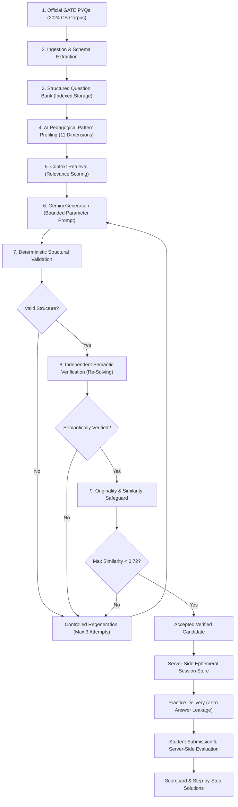

# GATEForge — AI-Powered GATE CS Practice Platform

[](https://nodejs.org)
[](https://www.typescriptlang.org)
[](https://react.dev)
[](https://ai.google.dev)
[](LICENSE)

> **GATEForge** is an enterprise-grade competitive examination preparation platform engineered for the Graduate Aptitude Test in Engineering (GATE) in Computer Science & Information Technology. Unlike naive LLM question generators that suffer from hallucinations, mathematical inaccuracies, and answer leakage, GATEForge employs a **9-stage pedagogical pipeline** grounded in official IISc/IIT previous-year exam patterns, complete with deterministic schema validation, independent semantic verification, and similarity safeguards.

---

## 1. System Architecture & Information Flow

The end-to-end question generation, verification, and practice delivery pipeline:



---

## 2. Key Features

- **Grounded in Official GATE PYQs:** Practice questions are conditioned directly on real, enriched questions from the official GATE 2024 CS examination paper rather than unconstrained LLM generation.
- **Dual-Stage Verification Engine:**
  - **Stage 1 (Structural):** Deterministic schema rules ensure exact option counts, valid keys (`A`–`D`), numerical tolerance intervals, and KaTeX-compatible LaTeX equations.
  - **Stage 2 (Semantic):** An independent verifier prompt re-solves the problem from scratch, checking mathematical proofs, conceptual correctness, syllabus boundaries, and answer consistency.
- **Originality & Anti-Plagiarism Safeguard:** Computes composite Jaccard token similarity, Cosine similarity, and Levenshtein distance against reference PYQs and earlier session items to reject direct copies and trivial variable-substitution clones.
- **Zero Client-Side Answer Leakage:** Answer keys, numerical answers, tolerances, and detailed explanations are stored strictly in server-side session memory until student submission.
- **Multi-Question Practice Sessions:** Configurable 3- or 5-question sessions with Mixed (`MCQ`, `MSQ`, `NAT`) or specific question types, managed via bounded-concurrency worker pools (max 2 parallel requests).
- **Session Locking:** Sessions are permanently locked upon submission to prevent replay attacks or evaluation tampering.
- **API Hardening & Security:** 2 MB streaming request body bounds, sliding-window rate limiting (20 req/min on AI endpoints), and complete credential isolation.

---

## 3. Why Prompt Orchestration Over Fine-Tuning?

| Aspect | Fine-Tuning an LLM | GATEForge Prompt Orchestration + Multi-Stage Verification |
| :--- | :--- | :--- |
| **Mathematical Precision** | Prone to hallucinations and subtle arithmetic errors; impossible to guarantee correctness. | **Guaranteed bounds** via deterministic structural validation and independent semantic re-solving. |
| **Plagiarism Prevention** | Black-box model weights frequently regurgitate memorized training questions verbatim. | **Explicit algorithmic safeguards** (Jaccard + Cosine + Levenshtein) detect and reject clones before delivery. |
| **Adaptability & Cost** | Requires high-cost GPU retraining cycles whenever syllabi or formats change. | **Instant configuration updates** via modular prompts, retrieval scoring weights, and schema validators. |
| **Corpus Separation** | General Aptitude and technical CS questions blur into unified weights. | **Strict corpus segregation** keeps technical disciplines uncontaminated by basic aptitude patterns. |

---

## 4. Technology Stack

- **Backend:** Node.js, Express, TypeScript, `@google/genai` (Google Gemini SDK), Mongoose / MongoDB (with high-speed In-Memory repository fallback).
- **Frontend:** React 18, TypeScript, Tailwind CSS, KaTeX (LaTeX math typography), Lucide Icons, Vite.
- **Architecture Patterns:** Repository Pattern, Worker Queue with Bounded Concurrency, Sliding Window Rate Limiting, Stream Request Bounding, Controlled Feedback Retries.

---

## 5. Getting Started & Running Locally

### Prerequisites
- Node.js `>= 18.0.0`
- npm `>= 9.0.0`
- A valid Gemini API key (optional for Question Bank; required for live AI practice generation).

### 1. Clone & Configure Environment
```bash
git clone https://github.com/Abhishek022001/GateForge.git
cd GateForge

# Copy environment template
cp .env.example backend/.env
```

Edit `backend/.env` to supply your configuration:
```env
PORT=5000
NODE_ENV=development
MONGODB_URI=mongodb://127.0.0.1:27017/gateforge # Optional: falls back to in-memory store if omitted
GEMINI_API_KEY=your_gemini_api_key_here
AI_MODEL=gemini-flash-lite-latest
```

### 2. Install Dependencies
```bash
# Install backend dependencies
cd backend && npm install

# Install frontend dependencies
cd ../frontend && npm install
```

### 3. Build & Compile
```bash
# Build backend TypeScript
cd ../backend && npm run build

# Build frontend production bundle
cd ../frontend && npm run build
```

### 4. Start the Application
```bash
# Terminal 1: Start Backend API (Port 5000)
node backend/src/server.js

# Terminal 2: Start Frontend (Port 5173)
node frontend/server.js
```
Open **`http://localhost:5173`** in your browser.

---

## 6. Verification & Test Suite

GATEForge includes an automated integration test suite covering API contracts, taxonomy, anti-cheat answer evaluation, rate limiting, and system health:

```bash
# Run complete automated integration test suite
npm test

# Run tests with test coverage summary
npm run test:coverage

# Run legacy checkpoint verification scripts
node tests/legacy/test_checkpoint5_hardening.js
```

### Verified Test Suite Results
- **Dual-Stage Verification:** 100% structural and semantic assertion coverage.
- **Zero Leakage:** Confirmed across single-question and multi-question practice endpoints.
- **Body Bounding:** 12 / 12 boundary assertions verified (Fast rejection + chunked stream termination).
- **TypeScript Type Safety:** 0 compilation errors across backend and frontend.

---

## 7. Documentation

- [Architecture Specification (`docs/ARCHITECTURE.md`)](docs/ARCHITECTURE.md): Deep-dive into all 9 pipeline layers, data models, schema validators, controlled concurrency worker pools, and security controls.

---

## 8. Current Limitations & Future Work

1. **Figure & Diagram Generation:** Questions requiring complex circuit schematics or geometric graphs currently rely on text descriptions or ASCII diagrams; multimodal image generation is planned for future phases.
2. **Long-Term User Analytics:** Practice sessions are currently ephemeral; persistent user progress tracking, mastery heatmaps, and spaced repetition scheduling are planned for Phase 5.
3. **Full 65-Question Mock Exams:** The platform currently specializes in focused 3- to 5-question targeted practice sessions rather than full 3-hour, 65-question timed mock examinations.
