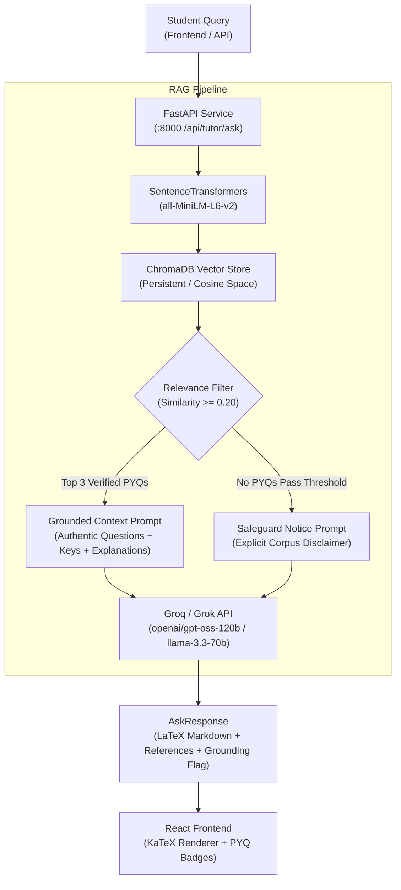

# GateForge RAG-Powered AI Tutor

An authoritative, source-grounded **Retrieval-Augmented Generation (RAG) AI Tutor** tailored specifically for the **GATE (Graduate Aptitude Test in Engineering) Computer Science & Information Technology** syllabus.

---

## 🏗️ Architecture Overview

The GateForge AI Tutor enhances student preparation by grounding LLM responses in **authentic GATE previous year questions (PYQs)**. Rather than relying on ungrounded hallucinations, the service searches a persistent ChromaDB vector store of 386 verified GATE questions and explanations, retrieves the top 3 most relevant anchors, and passes them as grounding context to Groq/Grok.



---

## 🚀 Key Features

1. **Authentic Corpus Ingestion**: Ingests all 386 verified official GATE CS questions (2022–2025) and conceptual seed questions from MongoDB directly into persistent ChromaDB storage.
2. **Deterministic Idempotency**: Question ingestion can be re-run at any time without creating duplicate vector records.
3. **Rigorous Grounding Safeguard**: If a query is irrelevant or outside the syllabus (e.g., cooking, non-CS questions), the system **never fabricates** retrieved question IDs or claims grounding. Instead, it marks `is_grounded: false`, returns an empty references list, and provides an explicit corpus notice.
4. **LaTeX & Mathematical Rigor**: All mathematical formulas, matrix operations, asymptotic bounds, and recurrence relations are rendered using LaTeX math notation (`$...$` and `$$...$$`) and displayed cleanly in the frontend via KaTeX.
5. **Multi-Model Fallback Chain**: Automatically tries `openai/gpt-oss-120b`, falling back to `llama-3.3-70b-versatile` and `llama-3.1-8b-instant` if rate limits occur.
6. **Unified Full-Stack Proxying**: The Node.js server (`backend/src/server.js`) on port 5000 proxies `/api/tutor/*` requests seamlessly to the FastAPI service on port 8000, returning a structured `503 TUTOR_SERVICE_OFFLINE` error if the Python tutor is not running.

---

## 📁 Directory Structure

```text
ai_tutor/
├── chroma_db/            # Persistent ChromaDB vector database files
├── venv/                 # Dedicated Python 3.12 virtual environment
├── config.py             # Pydantic configuration loader (.env & backend/.env)
├── models.py             # Pydantic schemas (AskRequest, AskResponse, HealthResponse, etc.)
├── ingest.py             # Repeatable, idempotent MongoDB -> ChromaDB ingestion pipeline
├── rag_service.py        # Core RAG retrieval, threshold filter & Groq LLM client
├── main.py               # FastAPI application with CORS and REST endpoints
├── test_tutor.py         # Automated unittest suite for FastAPI endpoints
├── requirements.txt      # Pinned Python package dependencies
└── README.md             # This architecture and setup guide
```

---

## ⚙️ Configuration & Environment Variables

Environment variables are loaded automatically from `backend/.env` or root `.env`:

| Variable | Description | Default |
| :--- | :--- | :--- |
| `MONGODB_URI` | MongoDB Atlas or local connection string | `mongodb://127.0.0.1:27017/gateforge` |
| `MONGODB_DB_NAME` | Database name containing questions collection | `test` |
| `GROQ_API_KEY` | Groq Cloud API key for ultra-fast inference | *Required for generation* |
| `GROK_API_KEY` | Alternative xAI Grok API key | Optional fallback |
| `AI_MODEL` | Primary LLM model identifier | `openai/gpt-oss-120b` |
| `AI_REQUEST_TIMEOUT_MS` | Bounded API request timeout in milliseconds | `30000` (30 seconds) |
| `CHROMA_PERSIST_DIR` | Directory path for persistent ChromaDB storage | `ai_tutor/chroma_db` |
| `EMBEDDING_MODEL_NAME` | HuggingFace sentence embedding model | `all-MiniLM-L6-v2` |
| `MIN_SIMILARITY_THRESHOLD` | Minimum cosine similarity to accept as grounded context | `0.20` |
| `TUTOR_PORT` | FastAPI listening port | `8000` |
| `TUTOR_HOST` | FastAPI binding host | `0.0.0.0` |

---

## 🛠️ Setup & Quickstart

### 1. Initialize Virtual Environment & Install Dependencies
```bash
python -m venv ai_tutor/venv
ai_tutor\venv\Scripts\pip install --no-cache-dir -r ai_tutor/requirements.txt
```

### 2. Ingest Questions into ChromaDB (Idempotent)
```bash
# Run ingestion script via npm or directly via Python:
npm run tutor:ingest
# or:
ai_tutor\venv\Scripts\python -m ai_tutor.ingest
```
*Output:*
```json
{
  "total_found": 386,
  "newly_indexed": 386,
  "already_indexed": 0,
  "total_in_collection": 386,
  "message": "Successfully indexed 386 questions into ChromaDB. Collection now has 386 items."
}
```

### 3. Start the FastAPI AI Tutor Service
```bash
# Start on port 8000:
npm run tutor
# or:
ai_tutor\venv\Scripts\python -m ai_tutor.main
```

### 4. Start the Node Full-Stack Platform
```bash
# In a separate terminal:
npm run dev:backend
# or production server:
npm start
```
The Node server (port 5000) automatically forwards all `/api/tutor/*` requests to `http://127.0.0.1:8000`.

---

## 📡 REST API Reference

### 1. `GET /api/tutor/health`
Returns readiness, collection size, MongoDB connection, and LLM configuration status.
```json
{
  "status": "ready",
  "questions_indexed": 386,
  "chroma_status": "connected",
  "mongodb_connected": true,
  "llm_configured": true
}
```

### 2. `POST /api/tutor/ask`
Submits a student's technical query to the RAG pipeline.

**Request Body:**
```json
{
  "query": "What is the minimum number of nodes in an AVL tree of height 5?",
  "subject": "Data Structures",
  "top_k": 3
}
```

**Response (`200 OK`):**
```json
{
  "query": "What is the minimum number of nodes in an AVL tree of height 5?",
  "answer": "### Core Concept & Theoretical Foundation\nAn **AVL tree** is a height-balanced binary search tree...",
  "is_grounded": true,
  "retrieved_references": [
    {
      "id": "gate-cs-ds-001",
      "question": "What is the minimum number of nodes in an AVL tree (height-balanced binary search tree) of height $h$...",
      "subject": "Data Structures",
      "topic": "Binary Search Trees & AVL Trees",
      "year": "2024",
      "question_type": "MCQ",
      "similarity_score": 0.692,
      "correct_answer": "B",
      "explanation": "Let N(h) be the minimum number of nodes in an AVL tree of height h. N(0)=1, N(1)=2, N(h)=N(h-1)+N(h-2)+1..."
    }
  ],
  "latency_ms": 1140.5,
  "model_used": "openai/gpt-oss-120b"
}
```

### 3. `POST /api/tutor/ingest`
Triggers repeatable question ingestion from MongoDB.
- Optional query parameter: `?force_reindex=true` (defaults to `false`).

### 4. `GET /api/tutor/subjects`
Returns distinct GATE subjects available for filtering.

---

## 🧪 Automated Testing

### Run Python API & RAG Unit Tests
```bash
npm run tutor:test
# or:
ai_tutor\venv\Scripts\python -m unittest ai_tutor/test_tutor.py
```
*Tests verify:*
- System health status and vector collection counts.
- Pydantic validation (length limits and bounds).
- Grounded query retrieval with similarity thresholds.
- Grounding safeguard against hallucination on out-of-domain queries.
- Ingestion idempotency (zero duplicates added on repeat calls).

### Run Full-Stack Integration Tests
```bash
npm test
```
All 22 integration tests across 7 test suites pass completely.
