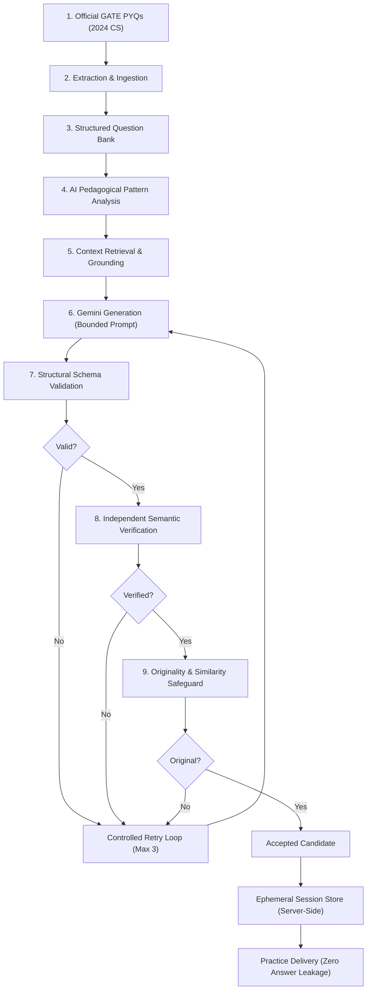

# GATEForge Architecture Specification

## 1. System Overview

**GATEForge** is an enterprise-grade, AI-powered preparation platform engineered for GATE Computer Science & Information Technology aspirants. Unlike naive LLM wrapper applications that prompt language models directly and output unchecked answers, GATEForge implements a **9-stage pedagogical pipeline** grounded in official GATE Previous Year Questions (PYQs). Every generated question undergoes structural schema validation, independent semantic verification (re-solving), and algorithmic similarity checking before reaching the learner.

---

## 2. The 9-Stage Pedagogical Pipeline

### Stage 1: Official GATE PYQs
- **Source Corpus:** Official GATE 2024 Computer Science (CS) examination papers and answer keys directly published by IISc/IITs.
- **Corpus Segregation:** Technical Computer Science disciplines are strictly partitioned from General Aptitude (GA) to preserve core technical depth and prevent distribution drift.

### Stage 2: Extraction & Ingestion
- **Deterministic Pipeline:** Parses raw exam papers and official master answer keys into standardized, validated JSON models.
- **Integrity Validation:** Every question is validated against strict GATE schema rules: question text, options (A, B, C, D) for MCQ/MSQ, numerical ranges and tolerance for NAT, subject, topic, year, marks, and provenance.

### Stage 3: Structured Question Bank & Storage
- **Repository Pattern:** Abstracts persistence behind `IQuestionRepository`, providing seamless switching between MongoDB and high-speed in-memory repository for local development and testing.
- **Indexing & Queries:** Multi-field filtering by subject, topic, subtopic, difficulty, question type (`MCQ`, `MSQ`, `NAT`), and source type.

### Stage 4: AI Pedagogical Pattern Analysis
- **11-Dimensional Pedagogical Profiling:** Analyzes official PYQs with Gemini to extract:
  1. `concepts`: Core theoretical concepts (e.g., *B+ Tree Indexing*, *Dynamic Programming*).
  2. `subConcepts`: Granular mechanisms (e.g., *Split condition on leaf overflow*).
  3. `reasoningType`: Multi-step reasoning modes (*conceptual*, *numerical*, *analytical*, *logical*, *code-tracing*).
  4. `cognitiveSkill`: Bloom's Taxonomy classification (*recall*, *understand*, *apply*, *analyze*, *evaluate*).
  5. `questionPattern`: Structural problem archetype.
  6. `solutionApproach`: Canonical problem-solving trajectory.
  7. `difficultyAssessment`: Calibrated difficulty (`Easy`, `Medium`, `Hard`).
  8. `distractorPatterns`: Common misconceptions targeted by distractors.
  9. `commonTraps`: Pitfalls examinees frequently encounter.
  10. `requiredKnowledge`: Prerequisite theorems and definitions.
  11. `gateCharacteristics`: Examination-specific design hallmarks.
- **Cost Protection:** Analysis results are cached on the question record; re-analysis is skipped unless explicitly forced.

### Stage 5: Context Retrieval & Grounding
- **Dynamic Retrieval (`getGenerationContext`):** When generating practice questions for a target subject, topic, or difficulty, the pipeline retrieves the top 3–5 most relevant analyzed official PYQs.
- **Scoring & Relevance:** Ranks questions by subject matching (+40), topic matching (+30), concept overlap (+15 per concept), reasoning type overlap (+10), and difficulty alignment (+10).
- **No Fine-Tuning Rationale:** Dynamic context retrieval grounds the model in current exam nuances without catastrophic forgetting, high training costs, or stale model weights.

### Stage 6: Gemini Generation (Structured Bounded Generation)
- **Model:** Google Gemini (`gemini-flash-lite-latest`) configured for deterministic low-latency generation.
- **Anti-Prompt Injection:** User-facing requests only accept strongly typed parameters (`subject`, `topic`, `difficulty`, `questionType`, `questionCount`). Arbitrary user prompt injection is strictly rejected.
- **Structured Output:** Enforces strict JSON output conforming to `IGeneratedQuestion`.

### Stage 7: Deterministic Structural Schema Validation
- **Zero Hallucination Tolerance:** Validates schema integrity before invoking downstream AI verifiers.
- **Type-Specific Rules:**
  - `MCQ`: Exactly 4 unique options labeled A, B, C, D; exactly one `correctAnswer` in `["A", "B", "C", "D"]`.
  - `MSQ`: Exactly 4 options; `correctAnswer` is an array of 1 to 4 unique valid option IDs.
  - `NAT`: No options; `correctAnswer` is a finite number or valid range `{ min, max }` with numerical tolerance.
- **LaTeX Sanity:** Validates balanced math delimiters (`$...$`, `$$...$$`) and KaTeX-compatible syntax.

### Stage 8: Independent Semantic Verification (Re-Solving)
- **Separate Verifier:** Generation and verification are strictly decoupled into independent prompts and execution contexts.
- **Candidate Re-Solving:** The semantic verifier receives the question and proposed answer, re-solves the problem independently, and verifies:
  1. Mathematical, logical, and conceptual accuracy.
  2. Question unambiguity and solvability.
  3. Strict alignment with stated GATE syllabus and difficulty.
  4. Consistency between explanation and proposed correct answer.
- **Rejection & Feedback:** If verification fails, structured failure feedback is captured to guide the retry attempt.

### Stage 9: Originality & Similarity Safeguard
- **Multi-Factor Algorithmic Check:** Evaluates generated candidates against all source reference PYQs and earlier accepted session questions using:
  1. *Jaccard Token Similarity* on normalized token sets (stop-word removal, LaTeX formula abstraction).
  2. *Cosine Similarity* on term-frequency vectors.
  3. *Levenshtein Edit Distance* on canonicalized problem statements.
- **Threshold Enforcement:** Rejects direct copies, simple paraphrases, and variable-substitution clones (`maxSimilarity >= 0.72`).
- **Originality Guarantee:** Ensures learners practice novel problems that test identical reasoning skills without rote repetition.

---

## 3. Ephemeral Practice Sessions & Anti-Answer Leakage

### Architecture
- **In-Memory Session Store:** Practice sessions (`3` or `5` questions) are managed server-side via `PracticeSessionService`.
- **Zero Client-Side Leakage:** The frontend receives only sanitized question projections (`id`, `question`, `options`, `subject`, `topic`, `difficulty`, `questionType`). The `correctAnswer`, `numericalAnswer`, `tolerance`, and `explanation` are held exclusively in server memory until final submission.
- **Session Locking:** Once submitted, a session is permanently locked. Re-submissions are rejected with HTTP 409 `SESSION_ALREADY_SUBMITTED`.
- **Bounded Concurrency:** Multi-question generation runs across a worker pool with bounded concurrency (max 2 parallel Gemini requests) with minimum inter-request pacing (100ms) to ensure API stability and avoid rate limits.

---

## 4. API Security & Hardening

| Protection | Implementation | Benefit |
| :--- | :--- | :--- |
| **Request Body Bounding** | Fast rejection at `2 MB` (`MAX_BODY_SIZE_BYTES`) via `Content-Length` + chunked stream termination | Shields against Denial of Service (DoS) from oversized payloads |
| **API Rate Limiting** | In-memory sliding window rate limiter (20 req/min per IP on AI endpoints) | Mitigates AI resource exhaustion and API quota depletion |
| **Credential Isolation** | Server-side `GEMINI_API_KEY`; zero frontend `VITE_*` secrets; `.env` strictly gitignored | Prevents credential leaks in client bundles |
| **Error Boundary & Graceful Degradation** | React `<ErrorBoundary>` + structured API error codes (`RATE_LIMIT_EXCEEDED`, `AI_SERVICE_UNAVAILABLE`) | Prevents blank screens; offers graceful retry and fallback |
| **Immutable PYQs** | Question Bank mutations restricted; AI practice questions are ephemeral | Prevents pollution of the official gold-standard PYQ corpus |

---

## 5. Technology Stack

- **Backend:** Node.js, Express, TypeScript, `@google/genai` (Gemini SDK), MongoDB / Mongoose (with In-Memory repository fallback).
- **Frontend:** React 18, TypeScript, Tailwind CSS, KaTeX (LaTeX math rendering), Lucide Icons.
- **Tooling:** Vite, ESLint, TypeScript compiler (`tsc`), automated regression test suites.
